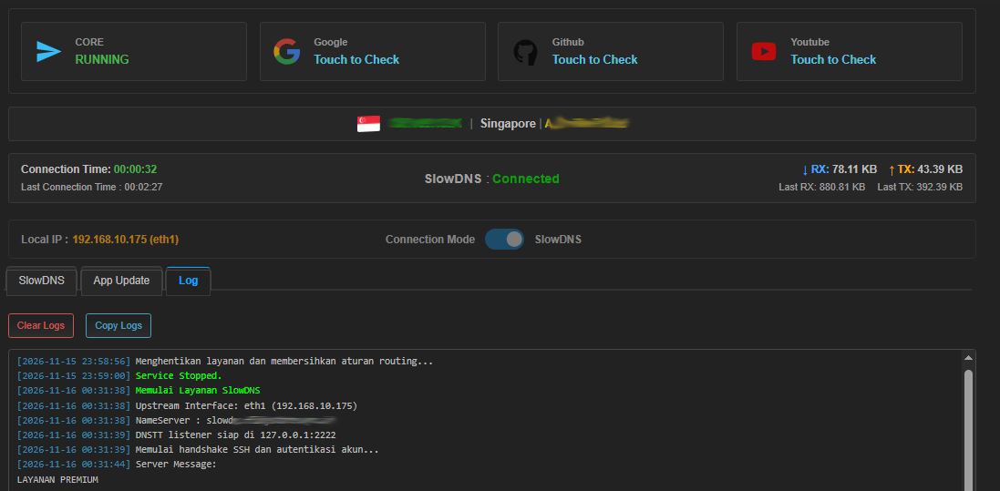

# Passwall-SSH untuk OpenWrt 24 & 25 🚀

Klien SSH Tunnel ringan untuk OpenWrt dengan antarmuka LuCI yang mendukung **HTTP Payload**, **TLS (Stunnel)**, **WebSocket**, **SlowDNS (DNSTT)**, dan **BadVPN tun2socks**. Dirancang hemat CPU/RAM serta dilengkapi watchdog otomatis agar koneksi tetap stabil.



## ✨ Fitur Utama
- Mendukung **OpenWrt 24 (`.ipk`)** dan **OpenWrt 25 (`.apk`)** di berbagai arsitektur router.
- **Mode SSH HTTP:** HTTP Payload (GET, POST, CONNECT, WebSocket), HTTP Proxy, dan TLS (Stunnel) dengan dukungan token payload (*case-sensitive*).
- **Mode SlowDNS (DNSTT):** Mendukung transport **UDP**, **DoH**, dan **DoT** dengan pilihan **QTYPE (`AUTO`, `NS`, `TXT`, `MX`, `CNAME`, `NULL`, `SRV`)**.
- **Built-in `badvpn-tun2socks`:** Lengkap dengan statistik koneksi, cek IP/latensi, monitor *Local IP upstream*, dan auto-reconnect watchdog.
- **App Update & Log:** Pembaruan paket langsung dari LuCI serta log diagnostik koneksi real-time.

## 🛠️ Instalasi
Unduh file paket sesuai versi OpenWrt dan arsitektur router dari halaman [**Releases**](https://github.com/avidemx/Passwall-SSH/releases), lalu install melalui SSH:

```bash
# OpenWrt 24
opkg update
opkg install --force-depends /tmp/passwall-ssh_24_*.ipk

# OpenWrt 25
apk update
apk add --allow-untrusted /tmp/passwall-ssh_25_*.apk
```

> **Catatan:** Saat ini hanya mendukung **IPv4**. Nonaktifkan IPv6 sebelum digunakan.

---

## ❤️ Thanks To

- ambrop72 (BadVPN)
- ChatGPT
- Gemini
